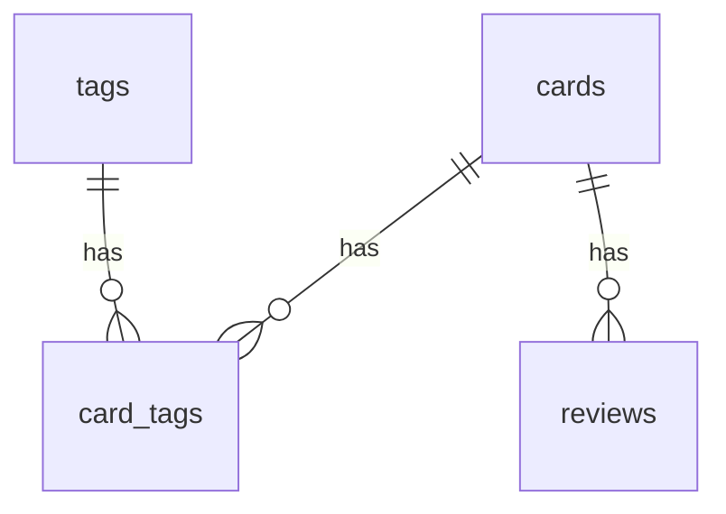

# DB 설계안 (docs/db-design.md)

> 상태: **적용됨** — `migrations/0001_init.sql`이 이 설계대로 표를 만든다. 구조를 바꿀 때는 이 파일이 아니라 새 번호의 마이그레이션(0002_…)을 추가하고, 이 문서와 백업 코드(`src/lib/backup/`)도 함께 고친다.
> 용어: **기본키(PK)** = 한 줄을 구분하는 번호. **외래키(FK)** = 다른 표의 줄을 가리키는 번호. **제약** = 잘못된 값이 들어오지 못하게 막는 규칙.

## 1. 표 관계 그림
```
cards ──< card_tags >── tags        (카드 ↔ 태그: 다대다)
  │
  └──< reviews                      (카드 1장 : 복습 기록 여러 개)

study_sessions   (독립)   settings   (독립)   schema_migrations (독립)
```
`──<` 는 "1 대 여러 개"를 뜻한다.



## 2. 표 정의

### cards (카드)
| 열 | 타입 | 제약 | 설명 |
|---|---|---|---|
| id | INTEGER | **PK** | 카드 번호 (자동 증가) |
| type | TEXT | NOT NULL, DEFAULT 'qa', CHECK(type IN ('qa')) | 카드 종류. 지금은 qa만 |
| question | TEXT | NOT NULL, CHECK(length(trim(question)) > 0) | 질문 |
| answer | TEXT | NOT NULL, CHECK(length(trim(answer)) > 0) | 내가 쓴 답 |
| source | TEXT | NULL 가능 | 출처 (선택) |
| box | INTEGER | NOT NULL, DEFAULT 1, CHECK(box BETWEEN 1 AND 5) | 라이트너 상자 |
| due_date | TEXT | NOT NULL | 복습 예정일 `YYYY-MM-DD` (서울 기준) |
| created_at | TEXT | NOT NULL, DEFAULT 현재 UTC | 만든 시각 |
| updated_at | TEXT | NOT NULL, DEFAULT 현재 UTC | 고친 시각 |
| deleted_at | TEXT | NULL 가능 | 비어 있으면 정상, 값이 있으면 보관함 (소프트 삭제) |

인덱스: `(deleted_at, due_date)` — 오늘 복습할 카드를 빨리 찾기 위함.

### tags (태그)
| 열 | 타입 | 제약 |
|---|---|---|
| id | INTEGER | **PK** |
| name | TEXT | NOT NULL, **UNIQUE**, COLLATE NOCASE (대소문자 무시), CHECK(length(trim(name)) > 0) |
| created_at | TEXT | NOT NULL, DEFAULT 현재 UTC |

### card_tags (카드-태그 연결)
| 열 | 타입 | 제약 |
|---|---|---|
| card_id | INTEGER | NOT NULL, **FK → cards(id)** ON DELETE CASCADE |
| tag_id | INTEGER | NOT NULL, **FK → tags(id)** ON DELETE CASCADE |
| | | **PK(card_id, tag_id)** — 한 카드에 같은 태그 중복 방지 |

인덱스: `(tag_id)` — "이 태그가 붙은 카드" 검색용. (card_id 쪽은 복합 PK가 이미 커버)

### reviews (복습 기록)
| 열 | 타입 | 제약 | 설명 |
|---|---|---|---|
| id | INTEGER | **PK** | |
| card_id | INTEGER | NOT NULL, **FK → cards(id)** ON DELETE CASCADE | 어느 카드 |
| result | TEXT | NOT NULL, CHECK(result IN ('wrong','unsure','right')) | 틀림/애매/맞음 |
| box_before | INTEGER | NOT NULL, CHECK(1~5) | 복습 전 상자 |
| box_after | INTEGER | NOT NULL, CHECK(1~5) | 복습 후 상자 |
| reviewed_at | TEXT | NOT NULL, DEFAULT 현재 UTC | 복습한 시각 |

인덱스: `(card_id, reviewed_at)`, `(reviewed_at)` — 카드별 기록, 날짜별 집계용.

### study_sessions (타이머 기록, 집중만)
| 열 | 타입 | 제약 | 설명 |
|---|---|---|---|
| id | INTEGER | **PK** | |
| started_at | TEXT | NOT NULL | 시작 시각 (UTC). 남은 시간 계산의 기준 |
| planned_minutes | INTEGER | NOT NULL, CHECK(> 0) | 계획한 집중 분 |
| ended_at | TEXT | NULL 가능 | 끝난/멈춘 시각 |
| status | TEXT | NOT NULL, DEFAULT 'running', CHECK(status IN ('running','completed','stopped')) | 진행/완료/중간 멈춤 |
| focus_seconds | INTEGER | NOT NULL, DEFAULT 0, CHECK(>= 0) | 실제 집중한 초 |

추가 규칙 (2가지):
1. `status='running'` 이면 `ended_at`은 NULL, 아니면 값이 있어야 한다(CHECK).
2. **진행 중인 타이머는 동시에 하나만** 있을 수 있다. `status` 열에 "부분 유니크 인덱스"(`WHERE status = 'running'`인 줄에만 적용되는 중복 금지 규칙)를 걸었다. 탭을 두 개 열어도 타이머가 둘 생기지 않게 DB가 막아 준다. (②단계에서 추가, `idx_study_sessions_one_running`)

휴식은 기록하지 않는다. 휴식 시작은 `started_at + planned_minutes`로 계산하고, 휴식 길이는 settings에서 읽는다.

### settings (설정)
| 열 | 타입 | 제약 |
|---|---|---|
| key | TEXT | **PK** |
| value | TEXT | NOT NULL |
| updated_at | TEXT | NOT NULL, DEFAULT 현재 UTC |

기본값(seed가 아니라 마이그레이션에서 넣음): `daily_review_limit=20`, `focus_minutes=50`, `break_minutes=10`, `font_size=16`.

### schema_migrations (적용한 마이그레이션 기록)
| 열 | 타입 | 제약 |
|---|---|---|
| filename | TEXT | **PK** (예: `0001_init.sql`) |
| applied_at | TEXT | NOT NULL, DEFAULT 현재 UTC |

### learning_sources (학습 기록에서 카드를 만든 줄의 기록) — 마이그레이션 0002
| 열 | 타입 | 제약 | 설명 |
|---|---|---|---|
| source_key | TEXT | **PK**, CHECK(소문자 16진수 16자리) | 줄의 고유 표식. 날짜+프로젝트+주제+몰랐던 점을 해시한 값 |
| status | TEXT | NOT NULL, CHECK(`imported`/`skipped`) | 카드로 만들었음 / 건너뛰기로 함 |
| card_id | INTEGER | NULL 가능, FK → cards(id) **ON DELETE SET NULL** | 만든 카드. 건너뜀이면 NULL (CHECK) |
| created_at | TEXT | NOT NULL, DEFAULT 현재 UTC | |

## 3. 왜 이렇게 나눴나 (쉬운 설명)

**learning_sources를 cards 안의 열로 두지 않고 따로 둔 이유**
"이 줄은 이미 처리했다"는 기억은 카드의 성질이 아니라 **줄(파일 쪽)의 성질**이다. 카드 표에 열로 넣으면 ① 카드를 지울 때 기억도 같이 사라져 같은 줄이 되살아나고, ② "건너뛰기"(카드가 없는 상태)를 담을 곳이 없다. 따로 두면 카드를 보관함에 보내거나 진짜 지워도(`ON DELETE SET NULL`) 표식은 남는다.

**카드와 태그를 왜 한 표에 안 넣었나?**
카드 한 장에 태그가 여러 개고, 태그 하나에 카드가 여러 장이다(**다대다**). 한 칸에 `"git,http"`처럼 넣으면 ① 태그별 검색·개수 세기가 어렵고 ② 오타(`Git`/`git`)가 쌓이고 ③ 태그 이름을 고치려면 모든 카드를 고쳐야 한다. 그래서 태그는 `tags`에 **한 번만** 적고, 연결은 `card_tags`에 한 줄씩 적는다. `PK(card_id, tag_id)` 덕분에 같은 연결이 두 번 들어가지 않는다.

**reviews를 왜 따로 두나?**
카드는 "지금 상태"(상자, 예정일)만 가진다. "언제 무엇을 했나"는 시간이 갈수록 늘어나는 기록이라 따로 쌓는다. 그래야 "오늘 맞음 몇 개?", "이 카드는 몇 번 틀렸나?"를 셀 수 있다. `box_before/after`를 같이 남기면 나중에 규칙을 바꿔도 과거 기록이 남는다.

**소프트 삭제(`deleted_at`)**
진짜 지우면 복원이 불가능하다. 값만 채워 두면 보관함에서 되살릴 수 있다. 대신 "정상 카드만" 조회할 때 항상 `deleted_at IS NULL`을 붙여야 한다.

**`due_date`만 서울 날짜 문자열인 이유**
시각은 UTC로 저장하는 게 원칙이다. 그런데 "복습 예정일"은 순간이 아니라 **달력의 하루**다. UTC로 저장하면 서울 자정 근처에서 하루가 어긋나기 쉽다. 그래서 이것만 서울 날짜 `YYYY-MM-DD`로 두면 `due_date <= '오늘'` 비교가 단순해진다(문자열 비교가 날짜 순서와 같다). reviews 같은 "순간"은 UTC로 두고, 필요할 때 `datetime(reviewed_at, '+9 hours')`로 서울 날짜를 계산한다.

**settings를 key-value로 한 이유**
설정은 줄 수가 적고 종류가 자주 바뀐다. 열을 늘리는 대신 한 줄씩 추가하면 마이그레이션이 필요 없다. 대신 값 범위 검사(예: 글자 크기 14~24)는 앱 코드에서 한다.

**CHECK / FOREIGN KEY**
앱 코드가 실수해도 DB가 마지막 방어선이 된다. SQLite는 외래키가 기본으로 꺼져 있어서, 연결할 때마다 `PRAGMA foreign_keys = ON`을 켠다(`src/lib/db/connection.ts`에서 처리).

## 4. 내가 직접 해 볼 SQL 연습
연습 문제와 풀이는 `docs/queries.md`에 있다. (오늘 복습할 카드, 태그별 개수, 복습 결과 세기, 오늘 집중 시간 합계, 틀린 횟수 많은 카드 …) 정답은 바로 주지 않고 힌트부터 준다.
